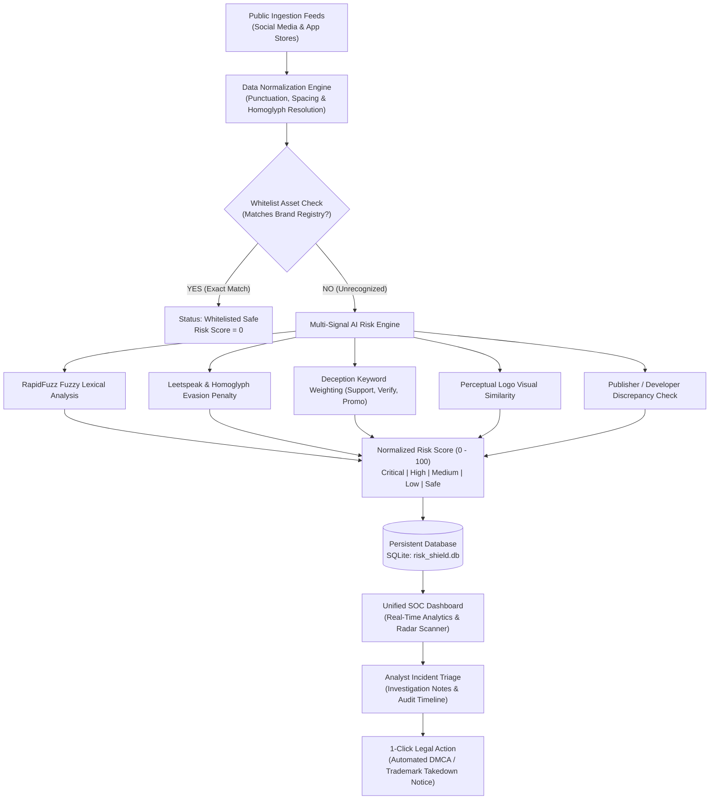
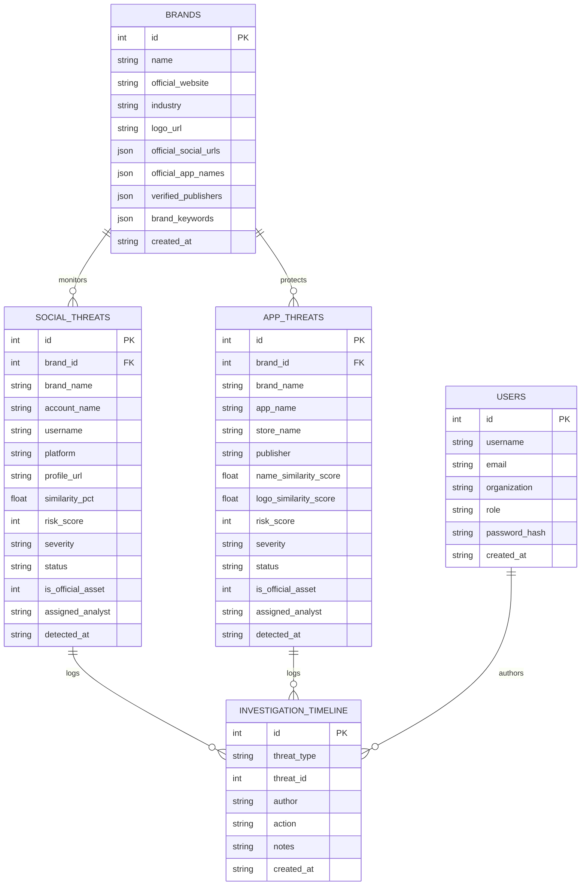

# Digital Risk Shield (DRS) — Complete Project Documentation

**System Title:** Digital Risk Shield — Digital Risk Protection & Brand Impersonation Detection System  
**Category:** Cybersecurity / Brand Protection / Artificial Intelligence  
**Version:** 2.4.0 (Hackathon & Capstone Engineering Edition)  
**Host URL:** `http://localhost:8000`  
**Swagger API Documentation:** `http://localhost:8000/docs`  

---

## 📑 Table of Contents

1. [Executive Summary & Problem Statement](#1-executive-summary--problem-statement)
2. [High-Level System Architecture](#2-high-level-system-architecture)
3. [Core Feature Breakdown (All 10 Modules)](#3-core-feature-breakdown-all-10-modules)
4. [AI Risk Detection Engine & Mathematical Scoring Logic](#4-ai-risk-detection-engine--mathematical-scoring-logic)
5. [Database Architecture & Data Models](#5-database-architecture--data-models)
6. [Complete REST API Specification](#6-complete-rest-api-specification)
7. [Technology Stack & Design Choices](#7-technology-stack--design-choices)
8. [Installation & Operational Guide](#8-installation--operational-guide)
9. [Step-by-Step Demonstration Walkthrough](#9-step-by-step-demonstration-walkthrough)
10. [Future Scope & Production Roadmap](#10-future-scope--production-roadmap)

---

## 1. Executive Summary & Problem Statement

### 1.1 The Problem
Modern organizations face an unprecedented rise in **brand impersonation attacks**. Cybercriminals exploit corporate reputations by:
- Creating spoofed social media accounts on X, Instagram, Facebook, and LinkedIn.
- Launching fake customer support handles (e.g., `@Apex_Support_Helpdesk`) to harvest user credentials and two-factor authentication codes.
- Publishing rogue mobile applications on third-party APK repositories and official app stores designed with trojanized payment gateways.
- Utilizing visual tricks like **homoglyphs** (Cyrillic characters mimicking Latin letters) and **leetspeak** (`0` for `O`, `rn` for `m`) to evade simple keyword filters.

Traditional threat intelligence platforms either produce overwhelming volumes of **false positives** or require costly enterprise subscriptions with opaque detection formulas.

### 1.2 The Solution: Digital Risk Shield
**Digital Risk Shield (DRS)** is an all-in-one, enterprise-grade cybersecurity operations platform that delivers:
1. **Explainable AI Detection:** Clear mathematical formulas breaking down exactly why a risk score was assigned.
2. **Whitelist-Driven False-Positive Elimination:** Registered brand assets automatically receive a score of 0.
3. **Multi-Vector Defense:** Unified monitoring across both social media profiles and mobile application stores.
4. **Analyst Incident Workflow:** Live triage, audit trail logging, and one-click legal **DMCA takedown notice dispatch**.

---

## 2. High-Level System Architecture

The following diagram outlines the complete data pipeline from initial ingestion to legal takedown:



---

## 3. Core Feature Breakdown (All 10 Modules)

### 3.1 Public Landing Page
- **Hero Section:** High-impact cybersecurity interface featuring an animated circular **Threat Vector Radar**, live ingestion badges, and quick CTA buttons.
- **Interactive Overview:** Visualizes the 4-stage pipeline (Register $\to$ Ingest $\to$ Multi-Signal Analysis $\to$ Triage).
- **One-Click SOC Demo:** Allows instant login for evaluators without filling out registration forms.

### 3.2 Authentication & Role-Based Access
- **Dual Modal:** Supports both login and organization onboarding.
- **Form Validation:** Input validation for emails, passwords, and organization identifiers.
- **Pre-Configured Demo Account:**
  - **Email:** `analyst@apexfinancial.com`
  - **Password:** `demo123`
  - **Role:** `Lead Risk Analyst`

### 3.3 Main Security Operations Center (SOC) Dashboard
- **Top 6 Real-Time Metric Counters:**
  1. *Total Brands Monitored*
  2. *Social Profiles Analyzed*
  3. *Mobile Apps Analyzed*
  4. *Potential Threats Detected* ($\ge 30$ Risk Score)
  5. *Critical Threats* ($\ge 80$ Risk Score, requiring urgent takedown)
  6. *Resolved Incidents* (Takedowns confirmed or whitelisted)
- **5 Dynamic Analytical Charts (powered by Chart.js):**
  - **Threat Trend Over Time:** Line chart mapping detections versus remediations.
  - **Platform Threat Distribution:** Bar chart showing social vector breakdown.
  - **Risk Severity Breakdown:** Doughnut chart showing proportions of Critical, High, Medium, Low, and Safe entities.
  - **Vector Comparison:** Donut chart comparing social threats against mobile store threats.
  - **Incident Status Breakdown:** Status distribution (New, Under Investigation, Confirmed, Resolved).
- **Recent Threats Live Feed:** Table displaying candidate icon, platform badge, risk gauge, severity, and instant investigate shortcut.

### 3.4 Brand Profile Management & Whitelist Engine
- **Asset Registration:** Form fields for:
  - Brand Name, Industry, Description, Logo URL.
  - Official Website URL.
  - Whitelisted Social Media Profile URLs (X, Instagram, Facebook, LinkedIn, YouTube, Telegram).
  - Whitelisted Mobile Application Names & Package IDs.
  - Verified Publisher / Developer Names.
  - Core Brand Keywords and Aliases.
- **Automatic Whitelist Rule:** Any profile or app whose URL or handle matches a registered asset is assigned a **Risk Score of 0** and labeled **"Safe / Whitelisted"**, eliminating false alarms.

### 3.5 Social Threat Monitoring
- **Platform Coverage:** Instagram, Facebook, X (Twitter), LinkedIn, YouTube, and Telegram.
- **Signal Highlighting:** Explicitly flags phishing customer support handles, deceptive giveaway bios, and spoofed avatars.
- **Multi-Level Filters:** Filter by platform, severity, brand context, and status.
- **Action Triggers:** View deep evidence, mark as legitimate, flag for investigation, or mark as false positive.

### 3.6 Mobile App Store Monitoring
- **Repository Coverage:** Google Play Store, Apple App Store, and third-party mirrors (APK Pure).
- **Discrepancy Matrix Modal:** Side-by-side comparison contrasting candidate apps with official brand applications across:
  - App Title Similarity.
  - Logo Imitation Percentage.
  - Developer / Publisher Reputation.
  - Package ID Discrepancies.

### 3.7 Look-Alike Name Risk Analyzer
- **Interactive Sandbox:** Evaluates candidate profile or app names against target brands.
- **Sensitivity Selector:**
  - *Strict:* Multiplier of $1.15\times$ for VIP executive and high-security banking brands.
  - *Balanced:* Standard baseline ($1.0\times$).
  - *Lenient:* Multiplier of $0.85\times$ for high-precision scenarios.
- **Output Cards:**
  - Normalized string comparison.
  - Detected character substitutions.
  - Deceptive keywords highlighted.
  - Numerical mathematical breakdown.

### 3.8 Unified Threat Investigation Center
- Centralized inventory managing both social media and mobile application threats in a single unified view.
- **Incident Dossier:**
  - Assign SOC analysts (e.g., Sarah Chen, Alex Mercer).
  - Update lifecycle status (*New*, *Under Investigation*, *Confirmed Threat*, *False Positive*, *Resolved*).
  - Append timestamped investigation notes with permanent audit history.

### 3.9 Automated DMCA / Trademark Infringement Notice Generator
- Generates legally compliant takedown requests conforming to **DMCA Section 512** and international trademark policies.
- Formats incident reference IDs, URLs, infringing evidence, and legal claims ready for immediate dispatch to platform abuse desks (Meta, X, Google Play, Apple).

### 3.10 Reports, Analytics & Multi-Format Exports
- Executive security summary with key performance indicators.
- Mean Time to Resolution (MTTR) and false-positive rate tracking.
- Strategic next steps generated from active findings.
- **Export Options:**
  - Export to **CSV** (Spreadsheet analysis).
  - Export to **JSON** (SIEM and SOAR automation).
  - **Print / PDF Summary** with optimized clean printable CSS.

---

## 4. AI Risk Detection Engine & Mathematical Scoring Logic

The detection engine is implemented in `backend/app/engine.py`. It calculates an explainable, multi-factor risk score between **0 and 100**.

### 4.1 Scoring Formula

$$\text{Risk Score} = \min\left(100, \max\left(0, \Big[\text{Base}_{\text{fuzzy}} + \text{Penalty}_{\text{sub}} + \text{Penalty}_{\text{kw}} + \text{Bonus}_{\text{contain}}\Big] \times \text{Sensitivity}\right)\right)$$

Where:
- $\text{Base}_{\text{fuzzy}} = (\text{RapidFuzz Ratio} \times 0.45) + (\text{Token Set Ratio} \times 0.25)$
- $\text{Penalty}_{\text{sub}} = \min(30, \text{Count}(\text{Substitutions}) \times 10)$
- $\text{Penalty}_{\text{kw}} = \min(45, \sum \text{Risk Points of Matched Phishing Terms})$
- $\text{Bonus}_{\text{contain}} = 20$ (if the brand root name is contained inside the candidate)
- $\text{Sensitivity} \in \{0.85, 1.0, 1.15\}$

### 4.2 Substitution & Homoglyph Mappings

The engine detects character replacements used to evade naive pattern matching:

| Category | Input Detected | Canonical Replacement | Threat Evasion Type |
| :--- | :---: | :---: | :--- |
| **Leetspeak** | `0` | `o` | Number substitution |
| **Leetspeak** | `1` or `\|` | `l` or `i` | Number substitution |
| **Leetspeak** | `3` | `e` | Number substitution |
| **Leetspeak** | `5` or `$` | `s` | Symbol substitution |
| **Leetspeak** | `@` | `a` | Symbol substitution |
| **Ligature Spoof** | `rn` | `m` | Multi-character visual mimicry |
| **Ligature Spoof** | `vv` | `w` | Multi-character visual mimicry |
| **Cyrillic Homoglyph** | `а`, `е`, `о`, `р`, `с`, `х` | `a`, `e`, `o`, `p`, `c`, `x` | Non-Latin character spoofing |

### 4.3 High-Risk Brand Keyword Dictionary

The engine identifies appended deception keywords that signal intent to defraud:

| Keyword Group | Examples | Point Weight | Indicator |
| :--- | :--- | :---: | :--- |
| **Support & Verification** | `support`, `official`, `helpdesk`, `verify`, `auth`, `care` | $+14$ to $+22$ pts | Credential harvesting / support impersonation |
| **Financial / Bait** | `rewards`, `airdrop`, `bonus`, `claim`, `free`, `giveaway` | $+20$ to $+25$ pts | Scam giveaway / crypto drainer |
| **Urgent Action** | `login`, `signin`, `unlock`, `urgent`, `recovery`, `billing` | $+16$ to $+22$ pts | Account takeover urgency |

### 4.4 Risk Severity Scale

| Score Range | Severity Label | Meaning | Action Trigger |
| :---: | :---: | :--- | :--- |
| **80 – 100** | **Critical** | Targeted impersonation with active phishing/evasion | Immediate takedown notice dispatch |
| **60 – 79** | **High** | Strong resemblance with deceptive keywords | Priority analyst triage |
| **30 – 59** | **Medium** | Partial similarity or fan discussion | Passive monitoring |
| **1 – 29** | **Low** | Coincidental lexical overlap | No action |
| **0** | **Safe** | Verified match with registered brand whitelist | Excluded from alerts |

---

## 5. Database Architecture & Data Models

The system uses SQLite (`backend/risk_shield.db`) for lightweight, persistent storage with zero configuration overhead.

### 5.1 Entity Relationship Diagram



---

## 6. Complete REST API Specification

All endpoints are hosted under `http://localhost:8000/api`:

### 6.1 Authentication & User Management
| Method | Endpoint | Description |
| :--- | :--- | :--- |
| `POST` | `/api/auth/login` | Authenticates analyst or demo session |
| `POST` | `/api/auth/register` | Registers a new organization or analyst |
| `GET` | `/api/auth/me` | Retrieves active user session profile |

### 6.2 Brand Management & Whitelist
| Method | Endpoint | Description |
| :--- | :--- | :--- |
| `GET` | `/api/brands` | Lists all monitored brand profiles |
| `POST` | `/api/brands` | Registers brand & official whitelist assets |
| `GET` | `/api/brands/{id}` | Retrieves specific brand details |
| `PUT` | `/api/brands/{id}` | Updates brand profile & assets |
| `DELETE`| `/api/brands/{id}` | Deletes brand profile |

### 6.3 Social Media Threats
| Method | Endpoint | Description |
| :--- | :--- | :--- |
| `GET` | `/api/social-threats` | Filterable list of detected social threats |
| `GET` | `/api/social-threats/{id}` | Detailed social threat record |
| `PATCH`| `/api/social-threats/{id}/status` | Updates incident status & analyst notes |
| `POST` | `/api/social-threats/scan-single` | Evaluates a single profile against whitelist |

### 6.4 Mobile App Store Threats
| Method | Endpoint | Description |
| :--- | :--- | :--- |
| `GET` | `/api/app-threats` | Filterable list of suspicious mobile apps |
| `GET` | `/api/app-threats/{id}/compare` | Generates discrepancy comparison matrix |
| `PATCH`| `/api/app-threats/{id}/status` | Updates app threat status & notes |
| `POST` | `/api/app-threats/scan-single` | Submits candidate APK/URL for analysis |

### 6.5 Interactive AI Analyzer & Scanning
| Method | Endpoint | Description |
| :--- | :--- | :--- |
| `POST` | `/api/analyze-name` | Live RapidFuzz & homoglyph analysis |
| `GET` | `/api/analyze-name/presets` | Pre-configured test presets |
| `POST` | `/api/scan/social` | Triggers social media crawler scan |
| `POST` | `/api/scan/apps` | Triggers mobile app store crawler scan |

### 6.6 Investigation & Reports
| Method | Endpoint | Description |
| :--- | :--- | :--- |
| `GET` | `/api/threats` | Unified threat inventory (Social + Apps) |
| `GET` | `/api/threats/{type}/{id}` | Full threat dossier with timeline history |
| `GET` | `/api/threats/{type}/{id}/takedown-notice` | Generates DMCA takedown letter |
| `GET` | `/api/stats` | Aggregated dashboard KPI counters & charts |
| `GET` | `/api/reports/summary` | Executive summary report data |
| `GET` | `/api/reports/export?format=csv` | Downloads CSV export |
| `GET` | `/api/reports/export?format=json`| Downloads JSON export |

---

## 7. Technology Stack & Design Choices

| Layer | Technology | Justification |
| :--- | :--- | :--- |
| **Backend Framework** | **Python FastAPI** | Asynchronous performance, automatic OpenAPI documentation, strict Pydantic validation. |
| **Server Engine** | **Uvicorn (ASGI)** | High-throughput web server capable of handling real-time API calls. |
| **Fuzzy Matching** | **RapidFuzz** | High-performance C-accelerated string comparison significantly faster than standard `fuzzywuzzy`. |
| **Image Analysis** | **Pillow (PIL)** | Image normalization and perceptual hashing preparation. |
| **Database** | **SQLite 3** | Serverless, zero-configuration, cross-platform persistence with transactions. |
| **Frontend Styling** | **Tailwind CSS** | Utility-first responsive design, dark mode, custom glassmorphism. |
| **Icons** | **Lucide Icons** | Consistent cybersecurity icon set. |
| **Visualizations** | **Chart.js** | Canvas-rendered responsive charts with dark theme tooltips. |
| **Application Client** | **Vanilla ES6+ Modules** | Zero build step required; runs directly in any modern browser. |

---

## 8. Installation & Operational Guide

### 8.1 System Requirements
- Windows, macOS, or Linux.
- Python 3.10+ installed and added to `PATH`.

### 8.2 Installation Steps
```bash
# Navigate to the project directory
cd "c:\Users\DELL\OneDrive\Desktop\risk detection 2"

# Install required packages
python -m pip install fastapi uvicorn pydantic rapidfuzz pillow
```

### 8.3 Running the Server
```bash
# Using the launcher script:
python run.py

# Or directly with Uvicorn:
python -m uvicorn backend.app.main:app --host 0.0.0.0 --port 8000 --reload
```

---

## 9. Step-by-Step Demonstration Walkthrough

Follow this demonstration script for college project evaluations, hackathon presentations, or security reviews:

### Step 1: Open the Application
Navigate to `http://localhost:8000`. You will see the **Landing Page** with the animated **Threat Vector Radar** and security statistics.

### Step 2: One-Click SOC Analyst Login
Click the **"1-Click SOC Analyst Demo"** button. The dashboard shell will open with dark-theme SOC metrics, charts, and preloaded sample threats.

### Step 3: Test Whitelist Exclusion (Zero False Positives)
1. Go to **Brand Profiles** in the left sidebar. Note that `Apex Financial` has `https://twitter.com/ApexFinancial` whitelisted.
2. Go to **Social Monitoring** and click **Evaluate Account**.
3. Enter:
   - *Brand:* `Apex Financial`
   - *Name:* `Apex Financial`
   - *Handle:* `@ApexFinancial`
   - *Profile URL:* `https://twitter.com/ApexFinancial`
4. Click **Run AI Threat Analysis**.
5. **Result:** The system returns **Risk Score: 0**, **Severity: Safe**, and labels it **Verified Whitelisted Asset**.

### Step 4: Test Phishing Support Evasion
1. In **Social Monitoring**, click **Evaluate Account** again.
2. Enter:
   - *Brand:* `Apex Financial`
   - *Name:* `Apex Official Customer Support Helpdesk`
   - *Handle:* `@apex_helpdesk_official`
   - *Profile URL:* `https://twitter.com/apex_helpdesk_phish`
3. Click **Run AI Threat Analysis**.
4. **Result:** The engine detects added keywords (`support`, `official`, `helpdesk`), computes fuzzy similarity, and assigns a **Critical Risk Score (90+)**.

### Step 5: Test Look-Alike Name Analyzer
1. Click **Name Risk Analyzer** in the left sidebar.
2. Click any of the one-click presets (e.g., `CloudScale -> Cl0udScale-Auth-Login`).
3. Click **Run AI Risk Analysis**.
4. Observe the mathematical breakdown:
   - Leetspeak substitution `'0' -> 'o'` detected.
   - Deceptive keywords `+auth` and `+login` detected.
   - Immediate natural language explanation generated.

### Step 6: Side-by-Side App Comparison
1. Click **App Store Monitoring**.
2. Find `Apex Mobile Banking - Fast Loan` and click **Compare**.
3. View the side-by-side discrepancy matrix comparing the rogue app against the official banking app.

### Step 7: Incident Triage & DMCA Notice Generation
1. Click **Threat Intelligence** in the left sidebar.
2. Click **Investigate** on any Critical threat.
3. Add an investigation note and click **Draft DMCA Takedown Notice**.
4. Click **Copy Notice** to copy the formal legal takedown demand.

### Step 8: Export Compliance Reports
1. Click **Reports & Analytics**.
2. Click **Export CSV** or **Export JSON** to verify instant file downloads.
3. Click **Print / PDF Summary** to view the print-ready executive briefing.

---

## 10. Future Scope & Production Roadmap

1. **Live Social Media Firehose:** Integration with official Twitter Developer Enterprise API and Meta Brand Protection Graph API.
2. **Deep Neural Network Vision:** Fine-tuned Vision Transformer (ViT) or ResNet-50 for high-accuracy logo trademark visual matching.
3. **Automated Abuse API Dispatch:** Webhook integrations with Cloudflare, Google Safe Browsing, and registrar abuse endpoints to automatically trigger domain suspensions.
4. **Multi-Tenant SSO:** SAML 2.0 / Okta integration for enterprise enterprise authentication.
